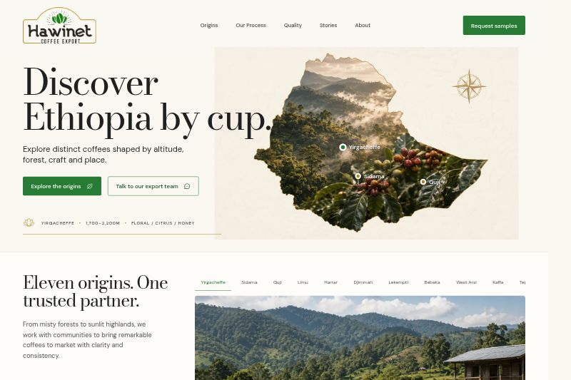

# Hawinet Coffee

A modern, responsive redesign for Hawinet Coffee Export. The experience presents Ethiopia's coffee origins through an interactive regional atlas, an editorial brand story, and a working sample-request flow.



## Highlights

- Interactive Ethiopian origin map and region selector
- Responsive desktop, tablet, and mobile layouts
- Functional sample-request modal that prepares a prefilled email to Hawinet's export team
- Accessible semantic controls, focus states, and reduced-motion support
- Locally bundled Bodoni Moda and DM Sans typography
- Vite production build with a Sites-compatible worker bundle

## Run locally

```bash
npm install
npm run dev
```

## Verify

```bash
npm run build
npm run test:sites
```

The sample form validates the buyer's details and prepares a prefilled email addressed to `info@hawinetcoffee.com`; it does not claim a request was received before the buyer sends it.
